<picture>
    <source media="(max-width: 700px)" srcset="assets/notebook-mobile-v3.svg" />
    
</picture>

#### ⚙️ `import toolkit`

also: LangChain · Pinecone · FAISS · YOLOv8 · Streamlit · MLflow

#### 📡 `me.contact()`

<code>me.projects</code> ↓ pinned below

